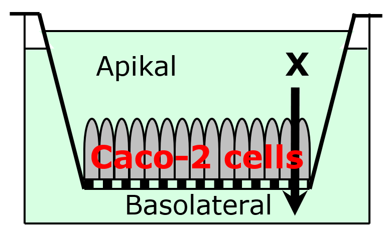

<!-- Herunder indsættes fil med jeres underskrifter -->


## Forord {.unnumbered}

<!-- Her angives fx brug af AI samt CRediT udtalelse om hvem der har gjort hvad  -->

Sebastian (SJ) stod for teori, dataanalyse, resultatafsnit, og diskussion. AI (i form af LLMs som Claude og ChatGPT) er blevet brugt til hjælp med sprog, formatering af Quarto dokument og til rådgivning ift. R-kode.

```{r}
#| label: setup

# SETUP: Denne kodeblok kan evt. bruges til at loade relevante pakker (tidyverse, knitr, etc) eller globale indstillinger.library(tidyverse)
library(tidyverse)
library(readxl)
library(knitr)
options(OutDec = ",") # Sætter komma som decimalseparator for kodeoutput (tabeller, plots, etc.). 
```

\newpage

# Introduktion

## Formål

<!-- Beskriv med egne ord, hvad formålet med øvelsen er. -->

Formålet med øvelsen er at bestemme permeabilitetskoefficienten ($P_{app}$) for lægemiddelstoffet **X** over et Caco-2 cellemonolag som *in vitro*-model for absorption over tarmepitelet.

## Teori

<!-- Her gennemgås det teoretiske baggrundsstof, relevante formler, etc. der er nødvendigt for at forstå øvelsens resultater og diskussion. Husk referencer og angivelse af hvad symboler betyder i angivne formler. OBS! Formål + Teori må max fylde 1 side i renderet Word dokument -->

Caco-2-cellelaget er afledt af humane coloncarcinomceller og anvendes som en udbredt *in vitro*-model for lægemiddelstoftransport over mave-tarm-epitelet [@hidalgo1989]. I et transportforsøg tilsættes lægemiddelstofkandidaten til den apikale (donor) side, og koncentrationen måles over tid på den basolaterale (receiver) side (@fig-caco2).

{#fig-caco2 width="40%"}

Når transporten når steady-state, er fluxen $J_{ss}$ (mængden af stof transporteret per tidsenhed per areal) proportional med koncentrationsgradienten over cellelaget. Den tilsyneladende permeabilitetskoefficient $P_{app}$ beregnes som:

$$
P_{app} = \frac{J_{ss}}{C_0}
$$ {#eq-papp}

hvor $C_0$ er den initiale donorkoncentration. For at koncentrationsgradienten kan antages konstant over forsøgets varighed, er det nødvendigt at opretholde *sink conditions* på receiversiden, dvs. at koncentrationen af **X** i receiverkammeret til enhver tid er betydeligt lavere end donorkoncentrationen. Som tommelfingerregel er sink conditions opretholdt, hvis den samlede transporterede mængde udgør mindre end 10 % af den initiale donormængde.

# Eksperimentelt

## Materialer og metoder

<!-- Her refereres der til øvelsesvejledning, samt evt. afvigelser fra øvelsesvejledningen. OBS!  Materialer og metoder + Databehandling må max fylde 2 sider i renderet Word dokument -->

Forsøget er udført som beskrevet i øvelsesvejledningen.

## Databehandling

<!-- Gennemgå relevante formler/beregninger samt beregningseksempler der er blevet anvendt til at analysere jeres data. Dette skal ikke vises som R kode, men som formler der beskriver databehandlingen. -->

Den kumulative transporterede mængde **X** blev beregnet med korrektion for de udtagne prøver, som løbende erstattedes med frisk buffer:

$$
n_{total,t} = C_{t} \cdot V_r + \sum_{i<t} n_{prøve,i}
$$ {#eq-ntotal}

hvor $C_t$ er koncentrationen i receiverkammeret til tiden $t$, $V_r$ er receivervolumet, og $n_{prøve,i}$ er mængden af **X** i de prøver udtaget før tidspunkt $t$. Her gives et regneeksempel efter 45 minutter:

$$
n_{total,t} = 0,26 \, \frac{nmol}{µL} \cdot 1000 \, µL + (3 \, nmol + 12 \, nmol) = 275 \, nmol
$$

Ved at plotte $n_{total}$ som funktion af tid kan steady-state-området identificeres som det interval, hvor kurven er tilnærmelsesvis lineær. En lineær regression på dette område giver en linje med hældningen $dQ/dt$ \[nmol/min\], hvorfra steady-state-fluxen beregnes som:

$$
J_{ss} = \frac{dQ/dt}{A}
$$ {#eq-jss}

hvor $A$ er cellelagets overfladeareal. $P_{app}$ beregnes herefter fra $J_{ss}$ og den initiale donorkoncentration som beskrevet i @eq-papp. Her ses et regneeksempel for $P_{app}$:

$$
P_{app} = \frac{13,66 \, \frac{nmol}{min}} {1,12 \, cm^2 \cdot 50 \, \frac {nmol}{µL} \cdot 1000 \, \frac {µL}{cm^3} \cdot 60 \, \frac {s}{min}} = 4,06 \cdot 10^{-6} \, \frac {cm}{s}
$$

Derudover bestemmes lagtiden som regressionslinjens skæring med x-aksen.

```{r}
# DATABEHANDLING: sker i baggrunden og vises ikke i rapporten

# Eksperimentelle parametre
V_d   <- 0.5    # Donor (apikal) volumen, mL
V_r   <- 1.0    # Receiver (basolateral) volumen, mL
V_s   <- 0.1    # Prøvevolumen udtaget fra receiver, mL
C_0   <- 50     # Initial donorkoncentration, mM
areal <- 1.12   # Overfladeareal, cm²

# Indlæs data
data <- read_excel("caco2_data.xlsx")

# Mængde X i hver receiver-prøve (nmol)
data <- data %>%
  mutate(n_sample_nmol = C_mM * V_s * 1000)

# Kumulativ transporteret mængde (nmol)
data <- data %>%
  mutate(n_total_nmol = C_mM * V_r * 1000 + cumsum(lag(n_sample_nmol, default = 0)))

# Filtrer steady-state-data og fit lineær model
ss_data <- data %>% filter(tid_min > 30)   # ___ juster grænse efter eget plot
fit <- lm(n_total_nmol ~ tid_min, data = ss_data)
skæring  <- coef(fit)[[1]]
hældning <- coef(fit)[[2]]
R2 <- summary(fit)$r.squared

# Resultater
pct_transporteret <- last(data$n_total_nmol) * 100 / (C_0 * V_d * 1000)
J_ss  <- hældning / areal          # nmol/(cm²·min)
t_lag <- -skæring / hældning       # min
Papp  <- (J_ss / 60) / (C_0 * 1000) # cm/s
```

# Resultater

<!-- Dette afsnit skal afrapportere de opnåede resultater i form af tal, tabeller eller figurer med tilhørende tabel- eller figurtekst. Husk også at beskrive jeres resultater med en brødtekst, der guider læseren igennem jeres observationer, uden at fortolke på data (hører til i diskussion). OBS! Resultatafsnittet må højst fylde en side i renderet Word dokument. -->

Den kumulative transporterede mængde af **X** steg tilnærmelsesvis lineært efter de første målepunkter, se @fig-transport. 

```{r}
#| label: fig-transport
#| fig-cap: "Kumulativ transporteret mængde af **X** over et Caco-2-cellemonolag som funktion af tid med tilpasset regressionslinje for steady-state-området. 50 mM **X** blev påsat donorsiden, hvorefter prøver fra receiversiden blev udtaget hver 15. minut over 120 minutter. Forsøget blev kørt ved 37 °C og en rotation på 220 rpm. Regressionslinjen har forskriften y = 13,66x - 341,7 og R^2^ = 0,9999. Værdierne repræsenterer enkeltbestemmelser (N = 1) i en enkelt cellepassage (n = 1)."

ggplot(data, aes(x = tid_min, y = n_total_nmol)) +
  geom_point(size = 2.5) +
  geom_abline(intercept = skæring, slope = hældning) +
  labs(x = "Tid (min)", y = "X transporteret (nmol)") +
  scale_x_continuous(breaks = seq(0, 125, 15),expand = expansion(mult = c(0, 0.05))) +
  scale_y_continuous(breaks = seq(0, 1500, 200), expand = expansion(mult = c(0, 0.05))) +
  coord_cartesian(clip = "off") +
  theme_classic()
```

Steady-state-området blev identificeret som tidspunkter efter 30 min. Efter 120 min var omkring 1300 nmol **X** transporteret over cellelaget, svarende til 5,18 % af den påsatte mængde.

```{r}
#| label: tbl-resultater
#| tbl-cap: "Lag-tid, steady state flux, og P~app~ for lægemiddelstofkandidaten **X** over et Caco-2-cellemonolag."

resultat_tabel <- tibble(
  lag_tid = signif(t_lag, 3),
  flux = signif(J_ss, 3),
  P_app = signif(Papp*10^6, 3)
  )

kable(resultat_tabel, col.names = c("Lag-tid [min]", "Flux [nmol/(cm^2^·min)]", "P~app~ ⋅ 10^-6^ [cm/s]"))
```

Beregnede værdier fra akkumulationsplottet, såsom lag-tid, flux og permeabilitetskoefficient (P~app~) er opsummeret i @tbl-resultater.

# Diskussion

<!-- Skal være et sammenhængende afsnit, hvori øvelsens resultater diskuteres i forhold til relevant baggrundsteori og litteratur. Studiespørgsmålene kan ofte (men ikke altid) indgå i dette afsnit. Husk angivelse af referencer. OBS! Diskussionsafsnittet må højst fylde 2 sider i renderet Word dokument. -->

Da kun 5,08 % af **X** blev transporteret over Caco-2-cellemonolaget over forsøgets længde, vurderes sink conditions at være opretholdt. Dette ses også afspejlet i den meget rette linje fra 45 min til 120 min i @fig-transport.

Den bestemte $P_{app}$ på $4{,}06 \cdot 10^{-6}$ cm/s antyder høj permeabilitet for **X** sammenlignet med referencestoffer med kendt oral absorption [@artursson2001]. Det skal dog bemærkes, at Caco-2-data alene ikke er tilstrækkeligt til at konkludere høj permeabilitet i BCS-sammenhæng. Ifølge ICH M9 bør permeabilitetsklassificering primært baseres på human farmakokinetik, fx absolut biotilgængelighed eller massbalancestudier, og Caco-2-resultater skal altid tolkes i sammenhæng med tilgængelige humane data [@ichm9]. Derudover fremgår det af ICH M9 Annex I, at Caco-2-assayet som udgangspunkt kun kan anvendes til klassificering af stoffer, der transporteres passivt, dvs. uden involvering af aktive transportproteiner. For at understøtte passiv transport bør det demonstreres, at $P_{app}$ er uafhængig af transportretningen, typisk udtrykt som en efflux ratio ($P_{app,BL \rightarrow AP} / P_{app,AP \rightarrow BL}$) under 2 [@ichm9]. I dette forsøg er der ikke udført bidirektionelle transportstudier, og transportmekanismen for **X** er derfor ikke afklaret, hvilket begrænser muligheden for at drage endelige konklusioner om permeabilitetsklasse på baggrund af dette forsøg alene. Derudover skal opløseligheden af **X** også bestemmes for klassificering ift. BCS.

# Konklusion

<!-- En kort konklusion, der opsumerer hvad der er blevet gjort og hvad man fandt ud af -->

Permeabilitetskoefficienten for **X** over Caco-2 cellemonolaget blev bestemt til $P_{app} = 4{,}06 \cdot 10^{-6}$ cm/s.

# Referencer

<!-- Her angives en liste over referencer (gøres automatisk hvis man har anvendt metoden med Zotero) -->

::: {#refs}
:::

\newpage

# Bilag {.appendix}

<!-- Her angives evt. bilag. Det kan fx være rådata, eller figurer og tabeller, der kan være relevant for læseren, men ikke nødvendige for at forstå resten af rapporten. Husk at give en lille forklaring til hvad hvert element i bilagslisten er. -->

```{r}
#| label: tbl-data
#| tbl-cap: "Rådata og behandlede data for transportforsøget."

kable(data, col.names = c("Tid [min]", "[X]~receiver~ [mM]", "n~prøve~ [nmol]", "n~total~ [nmol]"))
```
