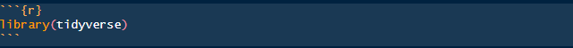
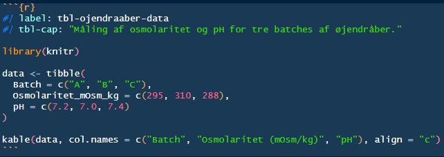
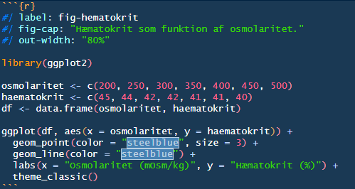
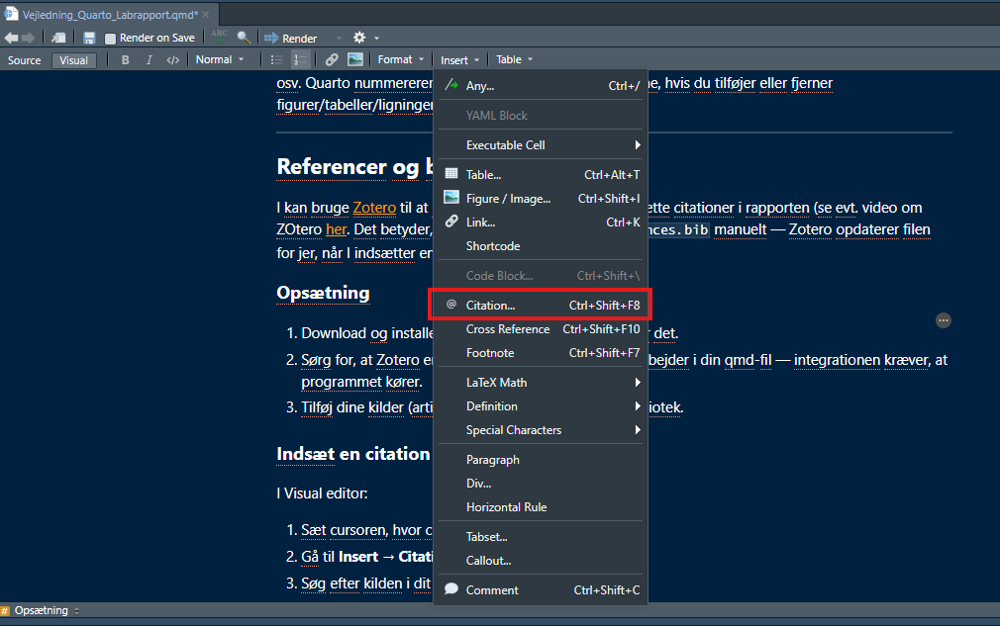
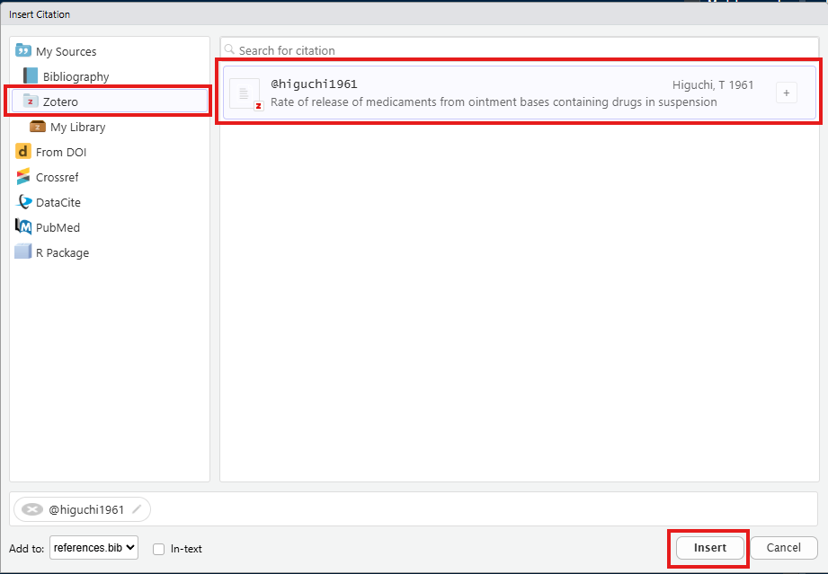

```{r}
#| echo: false 
options(OutDec = ",")
```

## Introduktion

Quarto er et værktøj, der gør det muligt at samle tekst, billeder, tabeller, figurer og R-kode i ét dokument og derefter "rendere" det til et færdigt dokument. I dette tilfælde er det et Word-dokument (.docx), som I skal afleverer jeres labrapport i. Læs mere om Quarto [her](https://quarto.org/docs/guide/).

RStudio har to måder at redigere en qmd-fil i:

-   **Visual editor**: ligner et almindeligt tekstbehandlingsprogram (a la Word). Du kan formatere tekst, indsætte billeder og citationer via menuer og genvejstaster, uden at se Markdown-koden direkte.
-   **Source editor**: viser den rå Markdown/Quarto-syntaks. Det er her, du f.eks. skriver ligninger, krydsreferencer og finjusterer kodeblokke.

Du skifter mellem de to via knapperne i øverste venstre hjørne af dokumentet.

## Mappestruktur og projektopsætning

Det kan være fordel at starte med at lave et R-projekt for hver rapport/labøvelse, hvor I får defineret en projektmappe. Projektmappen skal gerne komme til at indholde følgende filer:

```         
øvelse_X/
├── rapport.qmd
├── øvelse_X.Rproj
├── references.bib
├── vancouver.csl
├── reference.docx
└── figurer/
    └── (dine billeder/figurer)
```

**vancouver.csl** og **reference.docx** udleveres af os og skal ligge i samme mappe som din rapport.qmd-fil. Du skal **ikke omdøbe eller flytte** disse filer, de er allerede koblet til din rapport via YAML-headeren (mere om det i næste afsnit). Kort om hvad de gør:

-   `reference.docx` — en Word-skabelon, der bestemmer, hvordan dit rapporterede dokument ser ud (skrifttype, marginer, overskriftsformatering osv.), når det renderes til Word. Det er denne fil, der styrer udseendet, ikke noget du selv skal formatere i Word bagefter.
-   `vancouver.csl` — bestemmer, hvordan dine kildehenvisninger og litteraturliste formateres (Vancouver-stilen).
-   `references.bib` — selve filen, hvor dine kildehenvisninger gemmes. Den udfyldes automatisk, når du tilføjer citationer via Zotero (se afsnittet om referencer nedenfor).

Opret en mappe kaldet `figurer` og læg alle dine billeder og figurer der, så er det nemt at referere til dem i din qmd-fil.

## YAML-header

YAML-headeren ligger i toppen af din qmd-fil mellem to linjer med `---` og bestemmer dokumentets opsætning. I jeres skabelon ser i fx:

```         
---
title: "FA504: Titel på laboratorieøvelse"              
subtitle: "HX | Gruppe X+X | Øvelse udført: DD/MM-YYYY" 
author:
  - name: "Fulde navn (SDU brugernavn)"                
  - name: "Fulde navn (SDU brugernavn)"
  - name: "Fulde navn (SDU brugernavn)"
  - name: "Fulde navn (SDU brugernavn)"
  - name: "Fulde navn (SDU brugernavn)"
date: today
format:
  docx:
    reference-doc: reference.docx
bibliography: references.bib
csl: vancouver.csl
---
```

Det eneste, I selv skal udfylde, er:

-   `title` — titlen på jeres rapport
-   `subtitle`- skriv hold nr. + gruppe nr. + dato for øvelse
-   `name` — jeres navn(e) + SDU-brugernavn

Resten af felterne skal I ikke gøre noget ved. Der står en lille forklaring til hvert felt, hvis man er nysgerrig.

::: callout-important
YAML er meget følsom for mellemrum og indrykning. Hvis rendering pludselig fejler, er det ofte fordi der er kommet et ekstra mellemrum eller en linje er rykket forkert i YAML-headeren.
:::

## Markdown

I et Quarto-dokument formaters teksten ved at skrive Markdown tekst (i **Source editor** i RStudio). Man kan også formatere teksten ved brug af **Visual editor**. Her er en kort oversigt til hvordan man skriver Markdown tekst (læs også mere [her](https://quarto.org/docs/authoring/markdown-basics.html)):

| Du skriver       | Resultat                                              |
|------------------|-------------------------------------------------------|
| `# Overskrift 1` | Stor overskrift (flere `#` giver mindre overskrifter) |
| `**fed tekst**`  | **fed tekst**                                         |
| `*kursiv tekst*` | *kursiv tekst*                                        |
| `- punkt`        | Punktopstilling                                       |
| `1. punkt`       | Nummereret liste                                      |
| `super^script^`  | super^script^                                         |
| `sub~script~`    | sub~script~                                           |

## Kodeblok

En *R* Kodeblok indsættes ved at omkranse R-kode med tre backticks (\`) og `{r}`. Dette kan også gøres ved at bruge genvejen *Ctrl + Alt + I* (Windows) eller *Cmd + Option + I* (Mac). En renderet kodeblok ser ud på følgende måde:

{fig-align="center"}

```{r}
#| message: false
#| warning: false
library(tidyverse)
```

I jeres skabelon er der sat en global indstilling i YAML-headeren, som gør, at kildekoden i alle kodeblokke som udgangspunkt er skjult i det færdige Word-dokument, så kun resultatet vises:

```         
execute:
  echo: false      # Vis ikke kildekoden
  warning: false   # Skjul advarsler
  message: false   # Skjul meddelelser
```

I kan derfor frit bruge kodeblokke til databehandling, beregninger og statistik "i baggrunden", uden at koden fylder i rapporten. Hvis I i en enkelt kodeblok gerne vil vise koden alligevel, kan I overskrive den globale indstilling med `#| echo: true` i toppen af netop den kodeblok.

## Billeder

Indsæt et billede med følgende syntaks:

```         
{#fig-mitbillede width=400}
```

-   Stien `figurer/mit_billede.png` skal pege på, hvor billedet ligger i din projektmappe.
-   `{#fig-mitbillede}` giver billedet en label, så du kan referere til det i teksten (se afsnittet om krydsreferencer).
-   `width=400` styrer billedets bredde i pixels (kan også angives i %, fx `width=80%`). Juster efter behov.

Du refererer til billedet i din løbende tekst med `@fig-mitbillede`, hvilket f.eks. giver "Figur 1" eller "se Figur 1" afhængigt af, hvordan du formulerer det.

Læs mere om hvordan du indsætter og formatere billeder [her](https://quarto.org/docs/authoring/figures.html).

## Tabeller

### Manuelt skrevne tabeller

Dette er et eksempel på hvordan man manuelt kan lave en tabel i sit Quarto dokument (i **Source editor**).

```         
| Batch | Osmolaritet (mOsm/kg) | pH  |
|-------|-----------------------|-----|
| A     | 295                   | 7,2 |
| B     | 310                   | 7,0 |
| C     | 288                   | 7,4 |

: Måling af osmolaritet og pH for tre batches af øjendråber. {#tbl-ojendraaber-manuel}
```

Resultatet:

| Batch | Osmolaritet (mOsm/kg) | pH  |
|-------|-----------------------|-----|
| A     | 295                   | 7,2 |
| B     | 310                   | 7,0 |
| C     | 288                   | 7,4 |

: Måling af osmolaritet og pH for tre batches af øjendråber. {#tbl-ojendraaber-manuel}

Det kan måske nogle gange være nemmere at formatere tabeller ved brug af **Visual editor**. Læs mere [her](https://quarto.org/docs/authoring/tables.html#disabling-quarto-table-processing) for et mere dybdegående indblik i hvordan tabeller formateres.

### Tabeller fra data (knitr)

Hvis I har data i R, kan I generere en tabel automatisk med `kable()` fra `knitr`-pakken (læs evt. mere [her](https://www.geeksforgeeks.org/r-language/kable-method-in-r/)):

{fig-align="center"}

```{r}
#| label: tbl-ojendraaber-data
#| tbl-cap: "Måling af osmolaritet og pH for tre batches af øjendråber."
#| echo: false

library(knitr)

data <- tibble(
  Batch = c("A", "B", "C"),
  Osmolaritet_mOsm_kg = c(295, 310, 288),
  pH = c(7.2, 7.0, 7.4)
)

kable(data, col.names = c("Batch", "Osmolaritet (mOsm/kg)", "pH"), align = "c")
```

Bemærk `#| label:` og `#| tbl-cap:` i toppen af kodeblokken. Det er det, der  henholdsvis gør tabellen referérbar med `@tbl-ojendraaber-data` og giver dne en tabeltekst.

## Figurer (plots)

Plots indsættes på en lignende måde som tabeller, via en kodeblok med et label og en figurtekst:

{fig-align="center"}

```{r}
#| label: fig-hematokrit
#| fig-cap: "Hæmatokrit som funktion af osmolaritet."
#| out-width: "80%"
#| echo: false

library(ggplot2)

osmolaritet <- c(200, 250, 300, 350, 400, 450, 500)
haematokrit <- c(45, 44, 42, 42, 41, 41, 40)
df <- data.frame(osmolaritet, haematokrit)

ggplot(df, aes(x = osmolaritet, y = haematokrit)) +
  geom_point(color = "steelblue", size = 3) +
  geom_line(color = "steelblue") +
  labs(x = "Osmolaritet (mOsm/kg)", y = "Hæmatokrit (%)") +
  theme_classic()
```

Referér til figuren i teksten med `@fig-hematokrit`. Bemærk at `#| out-width:` fx. kan bruges til at kontrollere størrelsen af figuren. Ønsker man flere figurer ved siden af hinanden kan man tilføje `#| layout-ncol:` efterfulgt af antallet af figurer, man vil plotte ved siden af hinanden. Læs evt. mere om formatering af størrelsen af figurer [her](https://r4ds.hadley.nz/quarto.html#figure-sizing).

## Ligninger

### Inline

Brug enkelte dollartegn for at indsætte en ligning midt i en sætning:

```         
Fluxen beskrives ved Ficks første lov, $J = -D \frac{dC}{dx}$.
```

Resultat: 

Fluxen beskrives ved Ficks første lov, $J = -D \frac{dC}{dx}$.

### Blokligninger med nummerering

Brug dobbelte dollartegn og tilføj et label, hvis ligningen skal stå for sig selv og kunne refereres til:

```         
$$
J = -D \frac{dC}{dx}
$$ {#eq-fick}
```

Resultat:

$$
J = -D \frac{dC}{dx}
$$ {#eq-fick}

I kan nu referere til ligningen i teksten med `@eq-fick`, f.eks. "ifølge @eq-fick er fluxen proportional med koncentrationsgradienten".

------------------------------------------------------------------------

## Krydsreferencer

Samme system bruges til figurer, tabeller, ligninger og afsnit. Det vigtige er præfikset i label'et:

| Indhold   | Præfiks | Eksempel          |
|-----------|---------|-------------------|
| Figurer   | `fig-`  | `{#fig-eksempel}` |
| Tabeller  | `tbl-`  | `{#tbl-eksempel}` |
| Ligninger | `eq-`   | `{#eq-eksempel}`  |
| Afsnit    | `sec-`  | `{#sec-eksempel}` |

Når du har sat et label på, refererer du til det med `@` foran labelet, fx `@fig-eksempel`, `@tbl-eksempel` osv. Quarto nummererer automatisk og opdaterer numrene, hvis du tilføjer eller fjerner figurer/tabeller/ligninger.

------------------------------------------------------------------------

## Referencer og bibliografi (Zotero)

I kan bruge [Zotero](https://www.zotero.org/) til at holde styr på jeres kilder og indsætte citationer i rapporten (se evt. video om Zotero [her](https://www.youtube.com/watch?v=JG7Uq_JFDzE)). Det betyder, at I ikke selv skal skrive i `references.bib` manuelt, Zotero opdaterer filen for jer, når I indsætter en citation.

### Opsætning

1.  Download og installer Zotero, hvis du ikke allerede har det.
2.  Sørg for, at Zotero er **åben i baggrunden**, mens du arbejder i din qmd-fil — integrationen kræver, at programmet kører.
3.  Tilføj dine kilder (artikler, bøger osv.) til dit Zotero-bibliotek.

### Indsæt en citation

I Visual editor:

1.  Sæt cursoren, hvor citationen skal stå.
2.  Gå til **Insert → Citation**.
3.  Søg efter kilden i dit Zotero-bibliotek og vælg den.

{#fig-zotero1}

{#fig-zotero2}

Quarto tilføjer automatisk kildens fulde reference til `references.bib` og indsætter citationen i teksten i det rigtige format (Vancouver-stil, takket være `vancouver.csl`). For et mere generelt indblik i hvordan citationer håndteres i Quarto kan man læse mere [her](https://quarto.org/docs/authoring/citations.html).

### Litteraturliste

Litteraturlisten genereres automatisk i slutningen af dokumentet. Man kan også manualt angive hvor litteraturlisten skal være ved at indsætte følgende i Quarto-filen:

```         
## Referencer

::: {#refs}
::: 
```

Alle citerede kilder vil derefter automatisk blive listet under denne sektion med overskriften **Referencer**, når dokumentet renderes.

## Rendering til Word

Når rapporten er klar (eller I bare vil se, hvordan den ser ud undervejs), klikker i på **Render** knappen foroven. Det færdige .docx-dokument gemmes i samme mappe som din qmd-fil. Det er en god idé at rendere undervejs i skriveprocessen, så fanger I tidligt, hvis et billede, en label eller en citation ikke virker som forventet.
