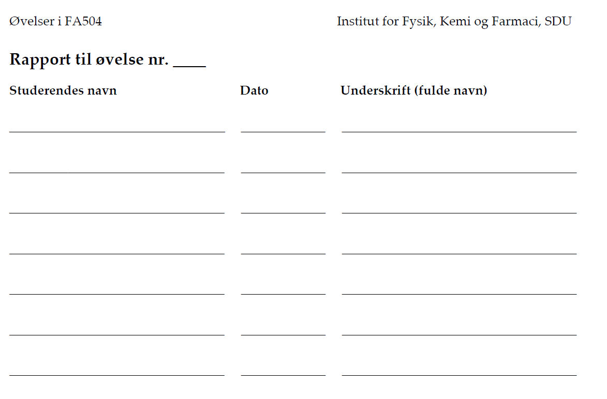

<!-- Herunder indsættes fil med jeres underskrifter -->



## Forord {.unnumbered}

<!-- Her angives fx brug af AI samt CRediT udtalelse om hvem der har gjort hvad  -->

A lavede X, B lavede Y og Z...


```{r}
#| label: setup

# SETUP: Denne kodeblok kan evt. bruges til at loade relevante pakker (tidyverse, knitr, etc) eller globale indstillinger.
library(tidyverse)
library(knitr)
options(OutDec = ",") # Sætter komma som decimalseparator for kodeoutput (tabeller, plots, etc.). 

```

\newpage

# Introduktion

## Formål

<!-- Beskriv med egne ord, hvad formålet med øvelsen er. -->

## Teori

<!-- Her gennemgås det teoretiske baggrundsstof, relevante formler, etc. der er nødvendigt for at forstå øvelsens resultater og diskussion. Husk referencer og angivelse af hvad symboler betyder i angivne formler. OBS! Formål + Teori må max fylde 1 side i renderet Word dokument -->

# Eksperimentelt

## Materialer og metoder

<!-- Her refereres der til øvelsesvejledning, samt evt. afvigelser fra øvelsesvejledningen. OBS!  Materialer og metoder + Databehandling må max fylde 2 sider i renderet Word dokument -->

## Databehandling

<!-- Gennemgå relevante formler/beregninger samt beregningseksempler der er blevet anvendt til at analysere jeres data. Dette skal ikke vises som R kode, men som formler der beskriver databehandlingen. I kan også bruge dette afsnit til at skrive al jeres kode der laver databehandlingen, men den vil ikke blive vist i det endelige dokument -->

```{r}
# DATABEHANDLING: I kan bruge denne kodeblok til at udføre jeres databehandling, som sker i baggrunden

```

# Resultater

<!-- Dette afsnit skal afrapportere de opnåede resultater i form af tal, tabeller eller figurer med tilhørende tabel- eller figurtekst. Husk også at beskrive jeres resultater med en brødtekst, der guider læseren igennem jeres observationer, uden at fortolke på data (hører til i diskussion). OBS! Resultatafsnittet må højst fylde en side i renderet Word dokument. -->

<!-- Husk at I kan indsætte kodeblokke til fx at producere plots med ggplot() eller tabeller med kable() -->

# Diskussion

<!-- Skal være et sammenhængende afsnit, hvori øvelsens resultater diskuteres i forhold til relevant baggrundsteori og litteratur. Studiespørgsmålene kan ofte (men ikke altid) indgå i dette afsnit. Husk angivelse af referencer. -->

# Konklusion

<!-- En kort konklusion, der opsummerer hvad der er blevet gjort og hvad man fandt ud af. OBS! Diskussionsafsnittet + konklusion må højst fylde 2 sider i renderet Word dokument. -->

# Referencer

<!-- Her angives en liste over referencer (gøres automatisk hvis man har anvendt metoden med Zotero) -->

::: {#refs}
:::

\newpage

# Bilag {.appendix}

<!-- Her angives evt. bilag. Det kan fx være rådata, eller figurer og tabeller, der kan være relevant for læseren, men ikke nødvendige for at forstå resten af rapporten. Husk at give en lille forklaring til hvad hvert element i bilagslisten er. -->
